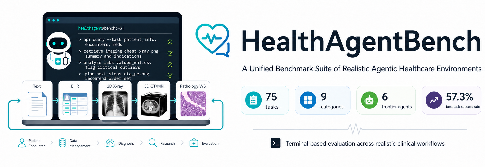
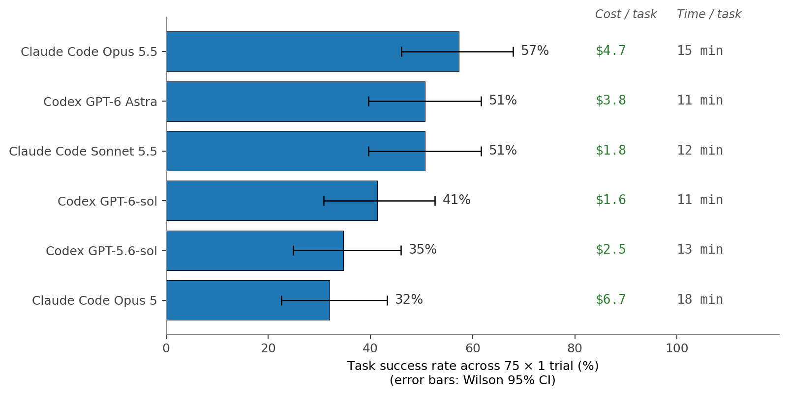

<p align="center">
  
</p>

<p align="center">
  <a href="https://microsoft.github.io/HealthAgentBench/">Website</a> -
  <a href="https://arxiv.org/abs/2606.31179">Paper</a> -
  <a href="https://github.com/microsoft/HealthAgentBench">Benchmark</a> -
  <a href="https://github.com/microsoft/HealthAgentBench/blob/main/README.md">Doc</a>
</p>

<p align="center">
  <a href="https://microsoft.github.io/HealthAgentBench/">
    
  </a>
  <a href="https://github.com/microsoft/HealthAgentBench/pulls">
    
  </a>
  <a href="https://arxiv.org/abs/2606.31179">
    
  </a>
  <br/>
</p>

## 📢 Updates
* 2026-09-15: We added the Pathology Tumor Slide Selection category (`pathology_tumor_slide_selection`, 10 tasks)
* 2026-07-27: We added results from Claude Code Opus-5 and Codex GPT-5.6-sol
* 2026-07-03: We released the benchmark.
* 2026-07-01: We released our [paper](https://arxiv.org/abs/2606.31179) and [website](https://microsoft.github.io/HealthAgentBench/).


## Overview

**HealthAgentBench** is a terminal-based benchmark suite for evaluating agents on
realistic health tasks. Each task drops an agent into a terminal environment
where it must inspect data, use tools, reason, and act to solve a concrete
clinical or biomedical problem, then a task-specific verifier scores the result. The figure below shows the main results from frontier agents on this benchmark. 

<p align="center">
  
</p>
<p align="center">
  <em>Previously reported results across 54 × 3 trials (Wilson 95% CI), with cost and time per task. The current suite contains 70 tasks; this figure does not cover the expanded suite.</em>
</p>

### Task Categories

HealthAgentBench currently ships **eight** task categories:

| Category (name in this codebase) | # Tasks | What is the task |
| --- | --- | --- |
| X-ray Report Correction (`xray_report_correction`) | 10 | Correct a chest X-ray radiology report for the latest MIMIC-CXR study, scored with the CheXprompt LLM judge verifier. |
| Pathology Tumor Area Selection (`pathology_tumor_area_selection`) | 10 | Predict the set of tumor-containing tiles over public whole-slide H&E pathology images. |
| Pathology Tumor Slide Selection (`pathology_tumor_slide_selection`) | 10 | Given several whole-slide H&E pathology images, identify which slides (possibly none) contain tumor (TCGA slides from the NCI GDC). |
| CT Abnormality Classification (`ct_abnormality`) | 10 | Patient-level chest-CT abnormality detection built on the CT-RATE dataset. |
| EHR Data Quality Auditing (`ehr_data_quality`) | 8 | Flag rows containing injected data-quality errors in a corrupted MIMIC-IV EHR subset. |
| EHR Event Modelling (`ehr_event_modelling`) | 6 | Predict future clinical events over longitudinal EHR timelines (Stanford SHAH lab's EHRSHOT benchmark). |
| EHR Compositional QA (`ehr_compositional_qa`) | 6 | Numerical clinical questions (severity scores, AKI stages, sepsis timing) answered from raw MIMIC-IV demo tables with a labelled training set: five sets of 7 to 15 questions split by question type plus one 51-question set; pass requires every answer correct. |
| Knee MRI QA (`mri_qa`) | 10 | Three knee MRI exams per task; answer ACL tear and meniscal tear for each from all three planes. All six answers must match the source labels. |
| **Total** | **70** | |

Each task has its own `README.md` under [`tasks/`](tasks/) with the task's category, success criteria, data/credentials, and commands to run that task or its whole category.


## Project Structure

```text
HealthAgentBench/                       # repo root
├── README.md
├── pyproject.toml                      # package + dependency config (uv; requires Python >=3.12)
├── .env.example                        # template for gated-dataset credentials
├── assets/                             # figures & media (banner, hero chart, and shared task category data assets)
├── website/                            # Astro leaderboard / docs site
├── LICENSE
├── SECURITY.md
└── tasks/                              # 70 Harbor tasks, one flat directory per task
    ├── xray_report_correction_case_*/         # 10 tasks - Longitudinal X-ray report correction
    ├── pathology_tumor_area_selection_slide_*/ # 10 tasks — WSI tumor-tile selection
    ├── pathology_tumor_slide_selection_set_*/  # 10 tasks — pick the tumor slides among several WSIs
    ├── mri_qa_set_*/                          # 10 tasks — three knee MRIs, ACL + meniscus tear per exam
    ├── ct_abnormality_valid_*/                 # 10 tasks — chest-CT abnormality detection
    ├── ehr_data_quality_task_*/                #  8 tasks — flag injected EHR errors
    ├── ehr_event_modelling_*/                  #  6 tasks — future clinical-event prediction
    └── ehr_compositional_qa_*/                 #  6 tasks — clinical QA over MIMIC-IV demo with a training set
```

All 70 tasks live as **flat, sibling directories** directly under `tasks/` — the task
directory name is prefixed with its category (e.g. `xray_report_correction_case_01`,
`ct_abnormality_valid_16_a_1`).
Every task follows the same Harbor layout (`task.toml` + `instruction.md` +
`environment/` + `tests/`) plus a `README.md` describing that task, how to run it, and
how to run its whole category.

## Setup

```bash
# Clone the repo
git clone https://github.com/microsoft/HealthAgentBench.git
cd HealthAgentBench

# Install dependencies
uv sync --all-extras
```

Python version requirement: `>=3.12`.

### Setting up task access

Some of the [task categories](#task-categories) above require gated datasets and
per-user credentials before the container can run. Obtain credentials following the
instructions below and fill in the credentials in `.env` (there is a file
`.env.example` showing the template).

- **ehr_event_modelling** — [EHRSHOT](https://stanford.redivis.com/datasets/53gc-8rhx41kgt)
  (Redivis, Stanford SHAH lab). Apply for access from [EHRSHOT](https://stanford.redivis.com/datasets/53gc-8rhx41kgt); once approved, create a 
  [Redivis API token](https://redivis.com/workspace/settings/tokens) and set it
  as `REDIVIS_API_TOKEN` in `.env`.
- **mri_qa** — [MRNet knee MRI](https://stanford.redivis.com/datasets/4a2c-4cpkzrn2c)
  (Redivis, Stanford AIMI). Apply for access on Redivis; the same
  `REDIVIS_API_TOKEN` in `.env` is used. Each task's bootstrap service downloads
  the axial, coronal, and sagittal series for its three exams (plus the label tables) on first run and
  caches them under `assets/mri_qa/assets/raw_cache/`.
- **ct_abnormality** — [CT-RATE](https://huggingface.co/datasets/ibrahimhamamci/CT-RATE)
  (Hugging Face, OpenRAIL gated). Accept the dataset agreement from [CT-RATE](https://huggingface.co/datasets/ibrahimhamamci/CT-RATE), then set your
  Hugging Face token as `HF_TOKEN` in `.env`.
- **xray_report_correction** — [MIMIC-CXR v2.1.0](https://physionet.org/content/mimic-cxr/2.1.0/)
  (radiology reports) and [MIMIC-CXR-JPG v2.1.0](https://physionet.org/content/mimic-cxr-jpg/2.1.0/)
  (JPG frames + metadata), both on PhysioNet. Once approved, set your PhysioNet
  username as `PN_USER` and password as `PN_PASS` in `.env`.


### Setting up other secrets

X-ray Report Correction is scored by an LLM-based judge based on the [CheXprompt](https://github.com/microsoft/chexprompt) verifier. We use GPT-5.4 as the default judge. **Configure one of two paths in `.env`** (the
verifier auto-detects which is present): **(a) vanilla OpenAI** — set `CHEXPROMPT_OPENAI_API_KEY` and optionally `CHEXPROMPT_OPENAI_BASE_URL`; or **(b) Azure OpenAI** —
set `CHEXPROMPT_AZURE_OPENAI_API_KEY`, `CHEXPROMPT_AZURE_OPENAI_ENDPOINT`, and `CHEXPROMPT_AZURE_OPENAI_API_VERSION`. To change the default judge, set `CHEXPROMPT_DEPLOYMENT` to a different model or deployment name.

The coding agent also needs credentials. For subscription authentication, run `claude setup-token` and set `CLAUDE_CODE_OAUTH_TOKEN` for Claude Code, or log in to Codex on the host and set `CODEX_FORCE_AUTH_JSON=1` to use `$HOME/.codex/auth.json`. Alternatively, configure `ANTHROPIC_API_KEY` for Claude Code or `OPENAI_API_KEY` for Codex. `ANTHROPIC_BASE_URL` and `OPENAI_BASE_URL` are optional and are only needed when using third-party endpoints. See `.env.example` for the template.

### Exporting environment variables from .env
Make sure you have `.env` at this repo directory so that the containers can read the environment variables. 
```bash
set -a; source .env; set +a
```

## Usage

We use Harbor to run evaluation. Refer to the [Harbor Background](#harbor-background) section for more details especially if you want to evaluate additional agents.

### Run the full HealthAgentBench Suite
`--n-attempts` specifies how many independent times each task is run and `--n-concurrent` specifies how many
trials run in parallel.
```bash
uv run harbor run \
  --path tasks \
  --agent claude-code \
  --model claude-opus-4-8 \
  --agent-kwarg reasoning_effort=xhigh \
  --agent-kwarg disallowed_tools="WebSearch WebFetch" \
  --n-attempts 1 --n-concurrent 5 \
  --jobs-dir <the output directory>  \
```

Harbor will print out a `mean` column that records the success rate and all the tasks' rewards (1 or 0) across the runs. You will find full results in the output directory. We also record additional metrics in addition to binary pass in `verifier/metrics.json` in each task subdirectory in output directory. 

Note: 
1. The harbor runs above will download data and mount the data to `assets/<task_category>/` to speed up multiple task setups using the same data assets. For one agent running all 70 tasks once with `--n-concurrent 5`, **250 GB of free disk space is a planning recommendation, not a measured minimum**. Existing shared dataset caches occupy about 73 GB, and completed single-agent sweep outputs occupy about 11–16 GB. Additional space is needed for Docker images/build caches, downloads, and up to five active task workspaces; peak use depends on the agent and task mix. Keep Harbor environment cleanup enabled. Allow space on both the repository and Docker data filesystems if they are separate; retained environments or repeated sweeps require additional capacity.
2. Some task families include answer keys or labels under `tasks/<task_name>/tests`; others fetch or derive gold labels during bootstrap. These files are for the separate verifier and must not be exposed to the agent. Run tasks through their Harbor environments rather than giving the agent the full repository.
3. The agent must not reach the internet, so it cannot look up gold labels online. This is enforced in three layers:
   - **Network allowlist (the actual block).** Every `task.toml` sets `[agent] network_mode = "allowlist"` with `allowed_hosts` limited to the Claude Code and Codex API domains (`anthropic.com`, `openai.com`, `chatgpt.com`, `openai.azure.com` for Codex via Azure OpenAI, and their subdomains). Harbor's egress-control sidecar drops every other connection from the agent container, so `pip install`, `curl` and Python `urlopen` fail. The verifier runs in a separate container with `network_mode = "no-network"` (the X-ray judge allowlists `api.openai.com` and `*.openai.com` by default), and the credentialed data bootstrap runs outside the sidecar and exits before the agent starts.
   - **Turn off the agents' own web tools.** For Claude Code pass `--agent-kwarg disallowed_tools="WebSearch WebFetch"` as in the commands above. For Codex pass `--agent-kwarg web_search=disabled`, which Harbor renders as Codex's `-c web_search="disabled"` config override (see the [Codex config reference](https://developers.openai.com/codex/config-reference)). Either flag alone is not an egress block; the allowlist is.
   - **Adding another agent.** To run an agent that talks to a different model API, add `--allow-agent-host your-api-host.example.com` to `uv run harbor run`. Repeat the flag for each additional API host; this extends the agent allowlist without modifying `task.toml`. Keep the added hosts limited to model API endpoints. Also disable that agent's own browsing or fetch tools if it has them. Harbor prints the allowlist at trial start; a no-op agent that tries `curl` against a few hosts is the quickest way to confirm only those hosts are reachable.
4. Check the exception errors (if any) reported by Harbor. We treat agenttimeout trials as failures (reward=0) when reporting the overall success rate.


### Run a single task


```bash
uv run harbor run \
  --path tasks/xray_report_correction_case_01 \
  --agent claude-code \
  --model claude-opus-4-8 \
  --agent-kwarg reasoning_effort=xhigh \
  --agent-kwarg disallowed_tools="WebSearch WebFetch" \
  --n-attempts 1 --n-concurrent 1
```

### Run a task category

Point `--path` at `tasks/` and glob the category name prefix with
`--include-task-name` (globs are supported; quote it so your shell doesn't expand
the `*`):

```bash
uv run harbor run \
  --path tasks \
  --include-task-name "xray_report_correction_*" \
  --agent claude-code \
  --model claude-opus-4-8 \
  --agent-kwarg reasoning_effort=xhigh \
  --agent-kwarg disallowed_tools="WebSearch WebFetch" \
  --n-attempts 1 --n-concurrent 5
```

Category prefixes for `--include-task-name`: `mri_qa_set_*`, `ct_abnormality_*`, `ehr_data_quality_*`, `ehr_event_modelling_*`, `ehr_compositional_qa_*`, `pathology_tumor_area_selection_*`, `pathology_tumor_slide_selection_*`, `xray_report_correction_*`


## Harbor Background

This project uses Harbor as the terminal-task execution and evaluation substrate. Harbor provides a consistent trial lifecycle (agent run, verifier run, and artifacts), while HealthAgentBench adds domain-specific health tasks, Harbor task environments, and benchmark integrations. Refer to the pointers below if you would like to run on additional agents supported by Harbor. 

Important pointers:

1. Harbor repo: https://github.com/harbor-framework/harbor
2. Harbor docs/wiki: https://deepwiki.com/harbor-framework/harbor
3. Stable Harbor version used here: `0.23.0` (see the `harbor==` pin in `pyproject.toml` and `uv.lock`; `uv sync` installs it). The task.toml fields used here (`[agent] network_mode = "allowlist"`, `[verifier] environment_mode = "separate"`, `artifacts`) need Harbor 0.23 or later.

## Citation

If you use HealthAgentBench in your research, please cite:

```bibtex
@misc{liu2026healthagentbench,
  title = {HealthAgentBench: A Unified Benchmark Suite of Realistic Agentic Healthcare Environments for Challenging Frontier AI Agents},
  author = {Liu, Qianchu and Zhang, Sheng and Qin, Guanghui and Valanarasu, Jeya Maria Jose and Rokuss, Maximilian and Lu, Mingyu and Ossowski, Timothy and Chaves, Juan Manuel Zambrano and Wong, Cliff and Argaw, Peniel and Hasija, Yashna and Wei, Mu and Yim, Wen-wai and Liu, Qin and Jing, Zilin and Entenmann, Jason and Usuyama, Naoto and Naumann, Tristan and Poon, Hoifung},
  year = {2026}
}
```


